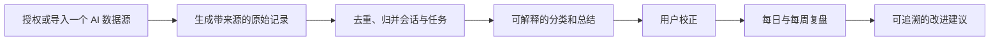

# AI 使用记录 Agent：现状评估与后续开发计划

> 2026-10-13 星图冒险版：已重构为「启程岛—专业世界—项目路线—对话关卡—逐次行动」的页面结构。已完成的 Codex 执行直接显示为已闯过；一键项目结算提炼宝藏、能力、检查点和投入效益，周战报显示成长与下一步。归类先依据项目线索给出暂定世界，AI 结算后更新；发送摘要仍需查看范围并同意。未归属项目的日常关卡技能汇总、同义专业技能合并，以及实际产物的自动核验仍是后续重点。

> 2026-10-13 当前版本：已转为「AI 能力世界」。通用 AI 技能使用固定七项，专业领域和技能由真实项目评估提出；界面按世界、路线、关卡展示，并加入原创合成音乐与音效。评估规则、证据边界及后续缺口见 [NEXT_VERSION_SPEC.md](NEXT_VERSION_SPEC.md)。以下早期评估与特工主题记录保留为历史，不代表当前页面。

> 最新进展：已恢复按需 AI 项目研判、学习版图、周复盘和下周建议。同步补存每轮 Codex 最终回复的短摘要，研判把重复请求归纳为独立里程碑，并为项目、对话和里程碑给出可核验的完成度与定性性价比。只有用户点击时调用轻量模型；分析结论随账号保存，数据变动后标记待更新。下一步应接入可验证的交付物证据、手动修订里程碑和跨平台数据源。

> 2026-10-11 更新：原型评估保留作历史依据。当前开发已完成本地账号后端、清空旧演示数据、真实记录统计、手动记录增改删与本机 Codex 日志一键同步。最新运行方式和已知边界见 [README.md](README.md)。后续优先事项是自动定时同步、更多数据源、可追溯的分析与正式服务器部署。

> 同日补充：Codex 同步已读取会话索引名称及实际请求预览，排除已识别的内部 Guardian 审查，并把记录分为项目、任务、对话；任务可手动关联。不同 AI 平台的历史读取能力需要分别核查，不能假设登录授权就能读取其全部对话。

> 后续实现：项目改用 Codex 本地项目元数据的真实名称与会话归属；历史项目目录不可用时保留并标注。逐轮完成事件记录 AI 处理历时，token 事件记录本次会话增量；对话在页面中按项目分组，侧边栏固定在视窗内。

> 同日界面更新：以原创现代游戏行动面板呈现任务档案、关卡和逐轮目标。目标文字来自清理后的用户输入摘要，完成轮次先标“待验收”；用户可逐目标确认“击败”或撤销，进度条只计算人工确认结果。后续若要自动判断目标是否解决，需要引入可核对的交付证据。

> 目标细分：连续编号的用户问题可在同一轮内拆成多个目标；时长与用量仍按轮次统计一次。非编号的复杂请求仍可能只显示为一个目标，未来可增加手动拆分与修订。

> 用词与视觉更新：参考《007：初露锋芒》官方介绍中的情报行动风格，界面统一“项目行动档案 → 对话执行阶段 → AI 轮次 → 目标核验”的关系；以原创深色、暖金色简报视觉替换霓虹绿，放大导航、正文、指标和目标卡片文字。旧版“怪物／击败／关卡”称谓不再出现在界面上。

评估日期：2026-10-11。评估范围：当前目录内唯一的 `index.html`（525 行，约 67 KB）。这是基于源码的评估；已检查内联 JavaScript 语法和页面元素引用，未进行浏览器端完整交互验收。

## 当前处于什么阶段

**可演示的本地前端原型。** 四个视图和手动记录的基本链路已经出现；“自动监管 AI 使用记录并总结”所需的数据采集、可信分析与真正的周期复盘尚未形成闭环。因此不宜把页面上的示例数值当作产品能力或真实用户结论。

| 能力 | 当前状态 | 依据 |
| --- | --- | --- |
| 今日时间线、任务库、学习版图、周度复盘界面 | 已有原型 | 四个视图及桌面导航；移动端只有前三个入口 |
| 手动补记、日期切换、状态修改 | 基本可用 | 表单、日期筛选、状态选择与重新渲染 |
| 本地持久化 | 初步可用 | 全部记录保存在当前浏览器的 `localStorage` |
| 自动判断 | 规则雏形 | 用关键词推断主子任务、进度和标签；没有模型调用或证据引用 |
| 自动采集 AI 对话 | 未实现 | 数据来自内置样例和手动表单 |
| 学习版图、周报 | 展示样例 | 节点百分比、时长、建议等写在 HTML 中，不随记录更新 |
| 数据维护与交付 | 未成型 | 缺编辑、删除、导入导出、备份、迁移、测试、说明及版本仓库 |

## 当前最需要修正的事实与逻辑

1. **记录会被内置样例重新注入。** 页面启动时以标题判断“缺失的种子记录”并加回；未来即使加入删除功能，沿用这段逻辑也会让删除失效。初始化样例应与真实数据分离，并只执行一次。
2. **“AI 时间分配”会重复计时。** 每条记录的“主任务/子任务”标签也被算入“其他”，其余多个能力标签还会各加一次完整时长。分类总时长可能超过实际记录总时长。应先定义互斥主分类，或明确标注多标签覆盖时长不可相加。
3. **“周度复盘”和能力分数是固定文案。** 近 7/30 天、迁移成功率、能力节点、下周建议没有真实计算；`近 30 天`按钮也没有交互。第一版真实复盘应只报告可追溯指标。
4. **当前“性价比”不是可靠的投入产出衡量。** 它由人工价值分、完成百分比和估计时长相除得到，短任务天然占优，且没有交付质量或实际结果证据。上线前宜改名为“粗略效率提示”，或暂时隐藏，直到定义与验证指标。
5. **状态与进度可以矛盾。** 标记“已完成”会把进度设成 100%；再改回“进行中”仍是 100%。任务库的“只看进行中”实际上包含“待跟进”。两者都需要统一状态规则。
6. **历史记录的出处和精度不明。** 内置 30 条记录的时长均标为估算，部分时间段可能互相重叠。日期、时长、来源、估算依据应保留在数据结构里，统计时区分精确值与估算值。
7. **移动端无法进入周度复盘。** 小屏幕隐藏侧边栏，而底部导航没有“周度复盘”。另外，选择过去日期后页面标题仍显示“今天”。

## 建议的产品闭环

每个自动结论至少能回答三个问题：**依据哪条对话或哪次手动补记、置信度如何、用户怎样纠正。** 先实现一个数据源的闭环，再扩展多个平台。数据获取方式需要按目标平台的实际授权、导出格式和可用接口确定。

## 分阶段开发

### P0｜把原型变成可信的本地记录器

- 拆分样例数据和真实数据；定义版本化记录模型：`id`、`source`、`sourceId`、开始/结束时间、时长及估算标记、原始文本或引用、任务 ID、父任务 ID、分类、状态、证据、人工修订。
- 增加编辑、删除、导入/导出 JSON、清空样例和错误恢复；先备份现有 `localStorage` 数据，再迁移。
- 修复时间分配、状态/进度、日期标题及移动端周报入口；界面明确区分“示例”“估算”“真实计算”。
- **验收：** 新用户能从空数据开始；新增、修改、删除、刷新和导出导入后记录一致；每天的互斥时间分类总量不超过当天记录时长；任一状态都有一致的完成度表现。

### P1｜接通一个真实数据源

- 先确定第一目标平台和合规获取方式。优先做用户主动导入的单平台适配器，再考虑持续自动同步。
- 建立导入预览、去重、时区处理、失败报告和撤销；原始记录只在用户指定范围内处理。
- 把“AI 使用次数”定义为会话、请求或任务中的一种，并明确计时方法，避免把不同口径混在一起。
- **验收：** 同一份数据重复导入不产生重复记录；每条汇总都能回到原始来源；导入失败不会覆盖旧数据。

### P2｜实现可纠错的 Agent 分析

- 将规则推断独立为可测试模块，先做任务归并、主子任务、主题标签、结果与待跟进事项；低置信度结果进入待确认列表。
- 在样本集上人工核对准确率；再决定哪些步骤需要模型。模型输出须保留依据和用户修订历史。
- 把价值判断与完成度分开：完成度基于交付状态，价值由用户评价或可观察结果支持，不直接用时长推断成效。
- **验收：** 用户能看到、修改和撤回每个自动判断；修订不会在下一次导入或分析后消失；总结不会把估算当成事实。

### P3｜做真正有用的复盘

- 从真实记录计算日/周统计、主题变化、未闭环任务及来源覆盖率；每个指标注明口径与样本量。
- 将学习版图改为可解释的能力证据视图；样本不足时不输出精确百分比。
- 下周建议连接具体任务、证据和预期行动；允许用户标记建议是否有效，形成反馈回路。
- **验收：** 换日期或新增记录后相关图表与周报随之变化；每条建议都能追溯到记录；空数据时不会出现预设结论。

## 开发顺序与边界

先完成 **P0 → P1 → P2 → P3**。当前最有价值的下一次开发是 P0：它能保护已有数据，并让后续自动导入和总结有稳定的基础。暂不需要先重做视觉、上云或接多个 AI 平台；这些决定应由单平台闭环验证后的实际使用需求推动。

开始 P1 前，需要确定首个记录来源（例如某一个 AI 产品的导出文件或授权接口）、“使用一次”的口径，以及用户希望记录的隐私范围。这三项会影响数据模型和采集方案。
